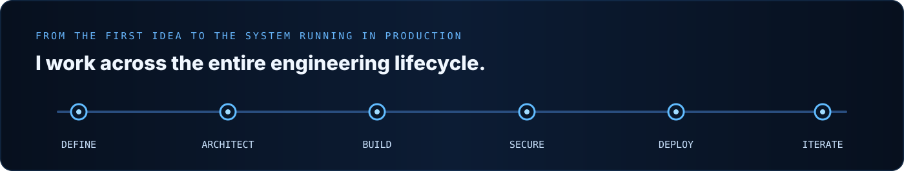
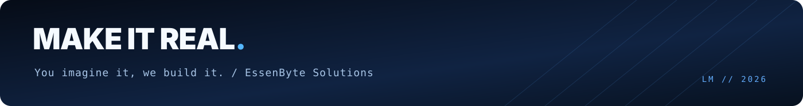

<!--
  L U C I A N - M I H A I   L U P Ș Ă
  Personal GitHub profile. Engineered, not templated.
  Assets are self-contained SVG files located in ./assets/.
-->

<div align="center">
  

  <br />

<a href="https://essenbyte.com"></a>
<a href="https://scoreengine.online"></a>
<a href="mailto:office@essenbyte.com"></a>

<br /><br />

<b>Software engineering &nbsp;·&nbsp; System architecture &nbsp;·&nbsp; Infrastructure &nbsp;·&nbsp; Robotics</b>

<br /><br />

<a href="#the-person-behind-the-code">About</a> &nbsp; • &nbsp;
<a href="#selected-work">Projects</a> &nbsp; • &nbsp;
<a href="#robotics-and-the-real-world">Robotics</a> &nbsp; • &nbsp;
<a href="#technologies-i-work-with">Tech stack</a> &nbsp; • &nbsp;
<a href="#lets-build-something">Contact</a>

</div>

<br />

## The person behind the code

I'm **Lucian-Mihai Lupșă** — the founder of **[EssenByte Solutions](https://essenbyte.com)**, a hands-on software builder, and a Robotics student at **POLITEHNICA Bucharest**.

I don't just put interfaces on screens. I design **how the whole thing works**: the product, its architecture, backend logic, data flows, authentication, infrastructure, deployment and ongoing operation. And when the problem moves into the physical world, I work with **electronics, embedded control, mechanical design and robots**.

**My favorite challenges are the ones that demand more than knowing a programming language.** They require connecting different engineering disciplines and owning the result from idea to reality.

> **Build for reality. Engineer for reliability. Never stop at “it works on my machine.”**

<p align="center"></p>

## What I actually do

<table>
  <tr>
    <td width="33%" valign="top">
      <h3><code>01</code> — Software</h3>
      <p>Design and build <strong>full-stack web platforms</strong>, APIs, role-based applications and real-time workflows. I care about clean architecture, maintainability, useful UX and the decisions users never have to think about.</p>
    </td>
    <td width="33%" valign="top">
      <h3><code>02</code> — Infrastructure</h3>
      <p>Operate <strong>Linux servers, containers, databases and production services</strong>. I work with deployment, authentication, security hardening, availability, logging and the unglamorous details that make software dependable.</p>
    </td>
    <td width="33%" valign="top">
      <h3><code>03</code> — Robotics</h3>
      <p>Engineer <strong>autonomous competition robots</strong> through CAD, fabrication, electronics, motor control, sensors and embedded software. Test in a real arena, discover what fails, improve, repeat.</p>
    </td>
  </tr>
</table>

## Selected work

<!-- Live project links, not fictional demo repositories. -->
<table>
  <tr>
    <td width="50%" valign="top">
      <h3>⚡ <a href="https://scoreengine.online">ScoreEngine</a></h3>
      <p><strong>Competition software, built as an ecosystem.</strong></p>
      <p>A platform I'm developing for managing the operational complexity behind real competitions — from registrations and teams to refereeing, event workflows and real-time coordination.</p>
      <p><code>Product architecture</code> <code>Full-stack</code> <code>Real-time systems</code></p>
      <p><strong><a href="https://scoreengine.online">Explore ScoreEngine →</a></strong></p>
    </td>
    <td width="50%" valign="top">
      <h3>◈ <a href="https://essenbyte.com">EssenByte Solutions</a></h3>
      <p><strong>My engineering brand. Built around execution.</strong></p>
      <p>Custom websites and applications, managed hosting, infrastructure and security. The work goes beyond writing code: I design, build, deploy and maintain the systems behind the product.</p>
      <p><code>Software engineering</code> <code>Linux / Docker</code> <code>Security</code></p>
      <p><strong><a href="https://essenbyte.com">Explore EssenByte →</a></strong></p>
    </td>
  </tr>
  <tr>
    <td width="50%" valign="top">
      <h3>🤖 <a href="https://challenge.relativity.ro">Relativity Robotics Challenge</a></h3>
      <p><strong>Engineering behind an international robotics event.</strong></p>
      <p>I contribute to its technical ecosystem, including participant workflows and the digital systems supporting competition operations — software that must make sense when real people depend on it.</p>
      <p><code>Event systems</code> <code>Competition tech</code> <code>Operations</code></p>
      <p><strong><a href="https://challenge.relativity.ro">Explore RRC →</a></strong></p>
    </td>
    <td width="50%" valign="top">
      <h3>⬡ <a href="https://voxelworks.ro">VoxelWorks</a></h3>
      <p><strong>Where code meets digital manufacturing.</strong></p>
      <p>A personalized-products project bringing together e-commerce, laser engraving, 3D printing and product customization. Building the software is only half the challenge: the manufacturing workflow matters too.</p>
      <p><code>E-commerce</code> <code>3D printing</code> <code>Laser engraving</code></p>
      <p><strong><a href="https://voxelworks.ro">Explore VoxelWorks →</a></strong></p>
    </td>
  </tr>
</table>

## Robotics and the real world

Some software is tested with unit tests. **My robots get tested against other robots.**

I design and build **Mega Sumo and Mini Sumo** robots, working across mechanical design, 3D printing, sensor integration, electronics, motor drivers and embedded control. That hands-on work makes me a better software engineer: real hardware has timing constraints, imperfect data and zero patience for fragile assumptions.

- **International competition experience** in autonomous robotics, including **Mega Sumo podium results in Rome and Kraków**.
- **Embedded development** with Raspberry Pi Pico, MicroPython, motor controllers, sensors and control logic.
- **Mechanical and electronic integration:** CAD, prototyping, custom hardware, assembly, testing and continuous redesign.

**[See my robotics portfolio →](https://robotics.essenbyte.com)**

## Technologies I work with

<!-- Focused list of tools used across active or ongoing engineering work. -->

**Languages and product development**

<p>


</p>

**Backend, operations and infrastructure**

<p>


</p>

**Hardware and prototyping**

<p>


</p>

## How I think about engineering

```text
A polished UI is good.       A reliable product behind it is better.
A clever algorithm is good.  A robot that wins in the arena is better.
A successful deployment     means nothing without security and operations.
A great idea                 deserves to become a working system.
```

<details>
  <summary><b>↳ View GitHub activity</b></summary>
  <br />
  <div align="center">
    
  </div>
  <p><sub>Stats are provided by an external service and may occasionally be unavailable. Private work is not fully represented by public GitHub statistics.</sub></p>
</details>

## Let's build something

I'm interested in **challenging software projects, dependable infrastructure and robotics that solve real engineering problems**. If your idea needs someone who can think beyond a single layer of the stack, let's talk.

<div align="center">
  <a href="https://essenbyte.com"></a>
  <a href="mailto:office@essenbyte.com"></a>
  <a href="https://www.linkedin.com/in/lucian-mihai-lup%C8%99%C4%83-696442277/"></a>
  <br /><br />
  
</div>
